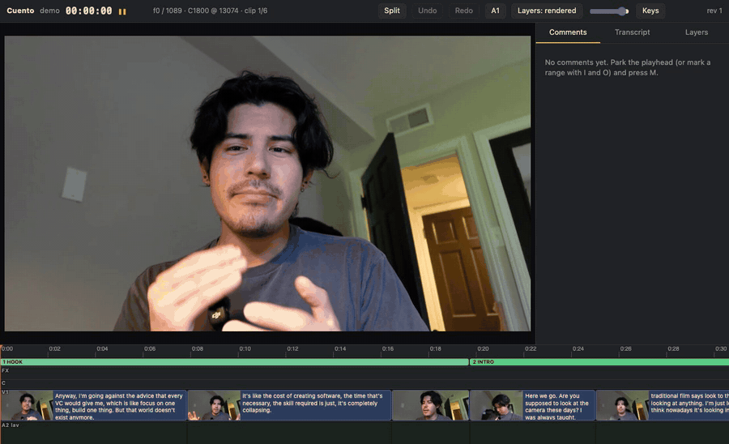
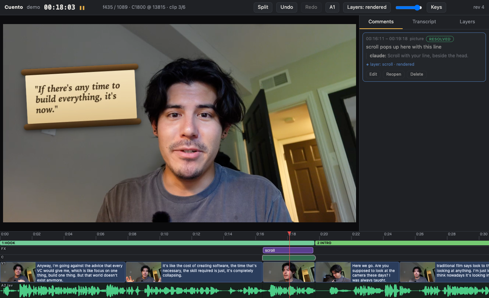

# Cuento

**A nonlinear video editor that lives inside Claude Code.**

It opens beside the chat like a living artifact. Cut real footage by hand with
J/K/L, drop a comment on any range, and Claude builds that one piece as its own
alpha layer. The whole video never re-renders.



<sub>A real session at 10 fps. The layer's render wait (about 10 seconds) is shortened.</sub>

Cuento is an open-source NLE with an MCP server and a `/cuento` skill. You trim
on a timeline with the keys you already know and leave comments on exact
ranges: "scroll pops up here", "tighten this", "warmer on the lav". Each
comment becomes one edit or one motion-graphics layer, rendered alone with an
alpha channel and composited live over the proxy.

```
/cuento open myfilm                     → the editor opens beside the chat
J K L · ⌘K · Q · W                      → skim at 8×, split, ripple trim
M  "pirate scroll pops up here"         → a comment on that exact range
"work the comments"                     → Claude builds one alpha layer for it
edit the comment                        → only that layer re-renders
```

Local-first: one small daemon, your footage stays on your disk, no account, no
upload, no Python packages, no Node.

## Why

Films first, tools second. Cuento exists because a real edit needed it:
talking-head footage, two microphones and a lot of on-screen graphics, where
re-rendering the whole video for every small change was not an option. So the
rule the whole thing is built on is simple. Every graphic is its own element with its own alpha
file, cached by a hash of its content. Change one, render one. Trim, move,
scrub, undo: render none.

## What works today

- **Timeline editing** on 540p proxies: J/K/L shuttle to 8×, frame stepping, add edit, ripple trims, lift and ripple delete, in/out marks, drag-to-trim, thumbnails and waveform.
- **Linked dual audio**: camera mic (A1) and external recorder (A2) follow every trim, split and move. The preview plays one or the other per clip, never a sum.
- **Comments as tasks** on exact ranges, for picture or either audio track. Editing a resolved comment reopens it.
- **Alpha layers**: HTML/CSS/canvas elements rendered frame by frame through headless Chrome to VP9-alpha WebM (preview) or ProRes 4444 (master), composited live in the browser.
- **One history**: hand edits and Claude's edits go through the same operations into the same project file, with undo and a snapshot per revision.
- **Versions**: keep a shorter and a longer cut of the same footage in one project. Tab switches between them at the same source moment; D marks what only this version has.
- **Chat passes with model tiers**: a Chat tab in the editor runs headless Claude Code passes. Edit is one continuing conversation that changes the timeline on a fast model; Story is a read-only pass on a stronger model that looks for the best story across your versions and hands its findings to the edit chat.
- **MCP server** with 28 tools (timeline, clips, versions, comments, layers, audio marks, transcript search, playhead, undo) and a `/cuento` skill.

Not built yet: person matte for text behind the head (M3), OpenTimelineIO /
Premiere / Resolve export (M4), voice comments (M5), brand kits (M6). See
[Known limits](#known-limits).

## Install

In the Claude desktop app the editor opens in the browser pane beside the chat.
From the terminal CLI it opens in your default browser. Same daemon, same project.

Requires macOS, Python 3.11+, ffmpeg (`brew install ffmpeg`) and Google Chrome
or another Chromium-based browser (set `CUENTO_CHROME`) for layer renders.

```bash
git clone https://github.com/ckaico/cuento.git ~/Projects/cuento
cd ~/Projects/cuento
claude mcp add cuento -s user -- "$PWD/bin/cuento" mcp     # MCP server, every session
ln -s "$PWD/skill" ~/.claude/skills/cuento                 # /cuento open <project>
```

Any MCP client works; the server is `bin/cuento mcp` on stdio:

```json
{ "mcpServers": { "cuento": { "command": "/path/to/cuento/bin/cuento", "args": ["mcp"] } } }
```

## Start a project

```bash
bin/cuento import-edl myfilm --edl cut.json --proxies path/to/proxies \
    --camera-dir path/to/camera/originals --lav-dir path/to/synced/audio
bin/cuento open myfilm          # starts the daemon, opens the editor
bin/cuento cam-audio myfilm     # optional: extract the camera mic so A1 can be auditioned
bin/cuento status | stop | list
```

An EDL is a JSON list of `{clip, in_frame, out_frame, section, text}`. Proxies are
`<clip>_proxy.mp4` at 24000/1001 with a keyframe every 12 frames and the synced
external audio as their audio track:

```bash
ffmpeg -i CLIP.MP4 -i CLIP_synced.wav -map 0:v -map 1:a -vf scale=960:540 \
    -c:v h264_videotoolbox -b:v 3M -g 12 -c:a aac -movflags +faststart CLIP_proxy.mp4
```

A `CUENTO.md` next to a project's `project.json` holds that project's look
references and house rules; Claude reads it when the project opens.

## Keys

| | |
|---|---|
| J K L | reverse · stop · play; tap again for 2× 4× 8× (audio to 2×, muted above); K+L / K+J slow; K + tap = one frame |
| Space, ←/→, ⇧←/→ | play/pause, one frame, five frames |
| ↑/↓, Home/End | previous/next edit, start/end |
| ⌘K | add edit at the playhead |
| Q / W | ripple-trim previous / next edit to the playhead |
| I / O / X | mark in, out, clip (Esc clears) |
| Delete, ⇧Delete or ⌥Delete | lift, ripple delete |
| M, ⇧M, ⇧⌘M | comment at playhead, next, previous |
| ⌘Z / ⇧⌘Z | undo / redo |
| Tab, D | switch version at the same moment, show what only this version has |
| = - \ | zoom in, out, fit |

Drag a clip edge to trim by hand. Double-click a clip on A1 or A2 to choose which
audio is heard for it.

## How it fits together



```
cuentod (local daemon, Python standard library only)
  ├─ project.json + history/   single source of truth, one snapshot per revision
  ├─ editor UI                 http://127.0.0.1:47821/?project=<name>
  ├─ JSON API                  the UI and the MCP server use the same operations
  └─ render worker             headless Chrome → PNG frames → VP9-alpha WebM / ProRes 4444
cuento mcp (stdio)             thin client of the daemon
```

- **Block**: `{source, in, out}` in whole frames. The timeline is a sequence of blocks and gaps.
- **Linked audio**: A1 and A2 are derived from the block, so they cannot drift from the picture. They are never summed: two mics at slightly different distances comb-filter.
- **Comment**: a task on a range and a target (picture, A1, A2).
- **Layer**: one HTML element on a 1920×1080 transparent stage, with a range, a z slot and its prompt history. Its render is keyed by a hash of its source and length.
- Comments, layers and audio marks ride on the clip they start in, so a ripple edit upstream carries them along.

### Versions and chat passes

```bash
bin/cuento add-version myfilm --edl long_cut.json --name "B full" --rename-current "A tight"
```

Each version carries its own sequence, layers and comments. Every edit tool works
on the active one; `timeline_get` and `version_diff` read any of them.

The Chat tab sends your message to `claude -p` with a role and a model per mode.
Passes run under your own Claude Code login and count against its usage; a story
pass over a ten-minute cut costs real tokens. Set the models in `~/.cuento/config.json`:

```json
{ "models": { "edit": "claude-opus-5-5", "story": "fable" } }
```

The edit pass may call every cuento tool and nothing else. The story pass may only
call the read-only ones.

### Writing a layer

Animations are seeked, not played, so a previewed frame and a rendered frame are
the same frame. CSS `@keyframes` and Web Animations work as written (use
`animation-fill-mode: both`). For canvas:

```html
<canvas id="c" width="1920" height="1080"></canvas>
<script>
  const g = document.getElementById('c').getContext('2d');
  cuento.onframe = (seconds, frame) => { g.clearRect(0, 0, 1920, 1080); /* draw */ };
</script>
```

Layers are self-contained: inline styles, inline SVG, data URIs. They have no
network access.

## Known limits

- `behind_person` layers draw over the picture until the person matte exists (M3).
- `backdrop-filter` has nothing to blur in an alpha render; glass panels need a composite-time blur (planned with export).
- Audio effects are stored on the timeline and shown on the track, but not applied to the preview mix.
- Reverse shuttle and speeds above 2× step the picture without sound.
- 23.976 fps projects only, for now.
- One writer: the daemon. Do not edit `project.json` by hand while it runs.

## Security

Local only, nothing uploaded, layers sandboxed. Details in [SECURITY.md](SECURITY.md).

## License

Apache-2.0. Copyright 2026 Christian Kai ([CKAI](https://ckai.co)). See [NOTICE](NOTICE).
